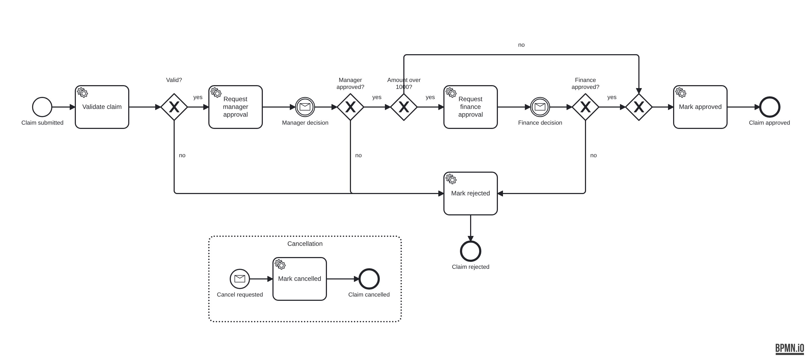

# Expense Claim Approval API

[](https://github.com/prajwal-jadhav01/approval-workflow-api/actions/workflows/ci.yml)

An ASP.NET Core (.NET 10) API for expense claims. The approval process runs as a **BPMN model on Camunda 8 (Zeebe)**: it validates the claim, waits for the manager, adds a finance step for large amounts, and lets the employee cancel at any point. The API owns the data and the business rules, and Camunda owns the order of the steps.

```bash
docker compose up -d --build     # API + Camunda 8 + Postgres
./scripts/smoke-test.sh          # walks three claims through the real process
```

## The process



- **Validate claim**: rejects amounts over the single-claim limit and duplicates (same employee, amount and category already in progress).
- **Manager decision**: a message catch event. The process waits until a manager calls the API, which publishes a `manager-decision` message correlated by claim id.
- **Amount over 1000**: an extra **finance decision** step.
- **Cancellation**: an interrupting event subprocess. A `cancel-claim` message stops the process wherever it is and marks the claim cancelled.

Each service task is handled by a **Zeebe job worker** inside the API (`Workflow/ZeebeJobWorkers.cs`). The BPMN model is deployed automatically on startup.

## Design

```
HTTP request ──► ClaimsController ──► ExpenseClaim (rules) ──► Postgres
                       │
                       └─► IWorkflowEngine ──► Zeebe: start process / publish message
                                                  │
Zeebe job ──► ZeebeJobWorkers ──► ClaimWorkflowHandlers ──► ExpenseClaim ──► Postgres
```

- **Rules live in the domain class.** `ExpenseClaim` refuses illegal moves (approving your own claim, deciding twice, approving a cancelled claim) whoever calls it, whether that's the API or the workflow. A broken rule becomes `409 Conflict` with a readable message.
- **Workers are idempotent.** Zeebe delivers a job at least once, so a step that already happened is a no-op, not an error. A failing job is retried 3 times with back-off, then raises an incident in Camunda instead of leaving the claim stuck without a trace.
- **Optimistic concurrency.** A version token on each claim means two approvers acting at the same moment can't overwrite each other: the second gets `409`.
- **Message de-duplication.** Decisions are published with a message id, so a double click can't advance the process twice.
- **The engine sits behind an interface** (`IWorkflowEngine`), so the API tests run without a Camunda cluster.

## API

All endpoints need a JWT bearer token. Roles: `employee`, `manager`, `finance`.

| Method | Path | Role | What it does |
|---|---|---|---|
| POST | `/api/claims` | employee | Create a draft claim |
| POST | `/api/claims/{id}/submit` | employee (owner) | Start the approval process |
| POST | `/api/claims/{id}/cancel` | employee (owner) | Cancel while in approval |
| POST | `/api/claims/{id}/manager-decision` | manager | `{ "approved": true, "comment": "..." }` |
| POST | `/api/claims/{id}/finance-decision` | finance | Same body, for claims over 1000 |
| GET | `/api/claims?status=PendingManager&page=1` | any | Employees see their own claims; approvers see all |
| GET | `/api/claims/{id}` | any | One claim |
| GET | `/api/claims/{id}/history` | any | Audit trail: who did what, when |
| GET | `/health`, `/metrics` | none | Health check (incl. database) and Prometheus metrics |

Interactive docs: http://localhost:8080/swagger (OpenAPI at `/openapi/v1.json`).

### Try it

```bash
TOKEN=$(curl -s -X POST localhost:8080/dev/token -H 'Content-Type: application/json' \
  -d '{"userId":"asha","roles":["employee"]}' | jq -r .accessToken)

curl -s -X POST localhost:8080/api/claims -H "Authorization: Bearer $TOKEN" \
  -H 'Content-Type: application/json' \
  -d '{"amount":4500,"currency":"INR","category":"hardware","description":"Keyboard and monitor"}'
```

`/dev/token` exists only so the project runs without an identity provider. It is off unless `Jwt:EnableDevTokens=true`. In production, tokens come from the company's IdP and the signing key from a secret store.

## Tests

- **Domain tests**: every state transition and rule in `ExpenseClaim`.
- **API tests**: the real app in memory (`WebApplicationFactory`) with SQLite and an in-process stand-in that follows the same path as the BPMN model. They cover the happy paths, rejection, cancellation, duplicates, role checks, a double decision (`409`), visibility between employees and validation errors.
- **End-to-end** (`scripts/smoke-test.sh`, run in CI): the real API, Camunda 8 and Postgres in Docker. A small claim, a large claim and a cancelled claim all go through the actual BPMN process.

```bash
dotnet test
```

## Metrics

Besides the standard HTTP metrics, `/metrics` exposes `claims_submitted_total` and `claims_completed_total{outcome="approved|rejected|cancelled"}`.

## Project layout

```
bpmn/                         the process model (generated by tools/generate_bpmn.py)
src/ClaimsApproval.Api/
  Domain/                     ExpenseClaim and its rules
  Controllers/                REST endpoints
  Workflow/                   Zeebe engine adapter, job workers, step handlers, metrics
  Data/                       EF Core DbContext and migrations
  Auth/                       JWT setup and roles
tests/ClaimsApproval.Tests/   domain + API tests
scripts/smoke-test.sh         end-to-end test against docker compose
```

## What I'd add next

- Camunda Operate and Tasklist in the compose file, for a visual view of running instances and incidents.
- A timer on the approval waits that reminds or escalates after a few days.
- An outbox table, so that saving the claim and starting the process can't drift apart if the API crashes between the two.
